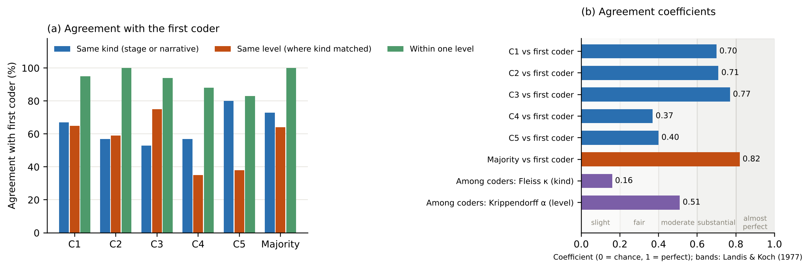
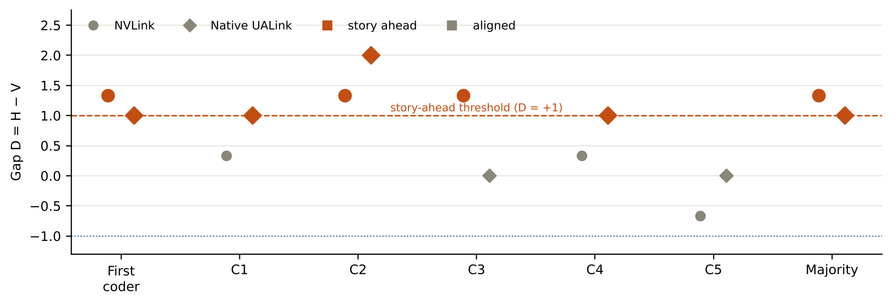
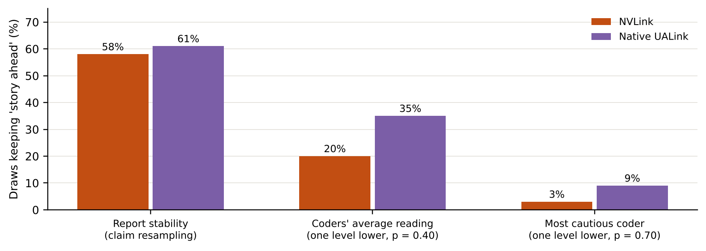
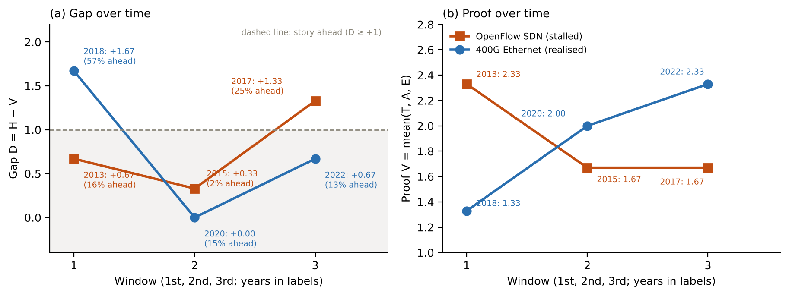

## Appendices

### Reader's Guide

The report scores each technology on five evidence parameters, combines three of them into proven value and compares that with what is claimed. The table defines every symbol, and the steps below show how to read a verdict.

| Symbol | Name | Question it answers | Scale |
| ---------- | ------------ | ------------------------------------ | -------------------- |
| H | Claimed maturity | How far along do vendors, promoters and analysts say it is | 0 to 4, from dated public claims |
| T | Technical proof | Has it worked outside the vendor's own demonstration | 0 to 4 |
| A | Adoption | Who has deployed it, and at what scale | 0 to 4 |
| E | Buyer economics | Has a buyer shown a gain against a matched baseline | 0 to 4 |
| Q | Capital quality | How solid is the money behind it | 0 to 4, reported beside the gap and never subtracted |
| V | Proven value | The mean of T, A and E | 0 to 4 |
| D | Gap | H minus V, positive when the story leads the proof | −4 to +4 |
| X | Gates | Power and grid, packaging, memory, lasers and export policy | Constrains or blocks, whatever the scores |
| Stability | Verdict stability | Share of 20,000 random re-scorings that keep the verdict | 0 to 100% |

**How to read a verdict.**

1. Start with the gap D. At +1.0 or more the story is ahead of the proof, at −1.0 or less the proof is ahead, and in between the technology is broadly aligned.
2. Check stability. Above about 90% the verdict is firm, and below that it is directional, so treat it as a signal to watch rather than a fact.
3. Look at which proof score is lowest. That is the evidence a buyer should ask for before committing.
4. Check the gates. A blocked gate stops a technology whatever its scores.
5. Read the posture in Table 1, which turns the verdict into an action, from deploy to defer, with the evidence that would move it up.

### Appendix 1. Research matrix

| Research question | Evidence | Method | Managerial output |
| --- | --- | --- | --- |
| Claim versus proof | Vendor and analyst claims, specifications, trackers, operator disclosures | Rubric coding on a shared 0 to 4 scale, gap D | Verdict per technology |
| Missing evidence | Buyer-side reliability, power and cost results | Leg diagnostics | What proof to demand |
| Capital and gates | Filings, bond data, supply and policy sources | Capital-quality score, non-compensatory gates, scenarios | Sequencing and exposure |
| Robustness | Scores and confidence grades | Alternative weights, 20,000-draw Monte Carlo | Stability per verdict |

### Appendix 2. Scoring rubric

| Level | H, claimed (summary, full scales below) | T, technical proof | A, adoption | Q, capital quality | E, buyer economics |
| --- | --- | --- | --- | --- | --- |
| 0 | Little or no claim | None | None | No committed capital | None |
| 1 | A future promise | Specification or simulation | Announced or sampling | Venture or strategic capital only | Vendor claim only |
| 2 | Imminent or early | Vendor or lab demonstration | Pilot or single buyer | Revenue, but concentrated, single-buyer or vendor-financed | One buyer-reported benefit or bounded vendor comparison |
| 3 | In production | Independent or buyer-side proof at scale | Two or more buyers | Revenue from several buyers backed by binding commitments | Buyer benefit against a matched baseline |
| 4 | The default | Multi-generation, operator-documented | Dominant share | As 3, low concentration, multi-year record | Lifecycle economics at several buyers |

**Claimed maturity (H) in full.** H is coded from dated public claims (Appendix 9), each classified as a stage claim (what deployment stage is asserted now) or a narrative claim (how the technology's maturity, momentum or destiny is framed). Architectural or value statements that assert no adoption, momentum or deployment are recorded but not counted.

| Level | Stage claim | Narrative claim |
| --- | --- | --- |
| 0 | No deployment claim (not counted) | Absolute decline, niche restriction, abandonment, or losing share with no offsetting growth |
| 1 | Specification or standardisation work, or a product more than 12 months out | Not ready yet, a premature launch, a long-term possibility or an open question |
| 2 | Launched, available, sampling, initial shipping, or deploying within 12 months | A promising contender or emerging challenger, or growing while losing relative share |
| 3 | Volume production, or in production at customers | Leading, winning majority share, gaining momentum, or set to dominate within about two years |
| 4 | Claimed as the default choice | Explicitly the default or standard now, or the inevitable eventual winner |

For each kind, the level is the highest that a strict majority of claims reach. The narrative level counts only with at least two narrative claims, and H is the higher of the stage and narrative levels. This is version 3.1 of the rule, which incorporates six clarifications proposed by a blind second coder.

Curve position is derived from the scores, not taken from Gartner. D of +1 or more with V below 1.5 is "promise outruns proof", and with V of 1.5 or more it is "peak claims". Negative D is "proof outruns talk". Otherwise V below 3 is "earning it" and 3 or more is "earned".

### Appendix 3. Source classes and course concepts

| Class | Examples | Used for | Limit |
| --- | --- | --- | --- |
| Filings and institutional data | SEC 10-K, 10-Q and 8-K, Berkeley Lab | Revenue, commitments, concentration | Check period and scope |
| Standards | Ultra Ethernet Consortium, UALink Consortium, OCP | What is specified and when | A specification is not a deployment |
| Peer-reviewed and conference papers | Meta at SIGCOMM 2024, ASPLOS 2025 | Production experience, reliability | Workload-specific |
| Originating analyst releases | Dell'Oro, IDC, Cignal AI, TrendForce | Market estimates and forecasts | Paid tables not read |
| Vendor documents and calls | Broadcom, Arista, Credo, AMD | Specifications, guidance | Interested party |
| Secondary reports | Trade press, conference write-ups | Operator talks not available in primary form | Confidence capped at medium |

| Course (term) | Concept | Use |
| --- | --- | --- |
| TBIT (3) | Business-IT alignment, why IT projects fail | Buyer-economics leg, buyer capability |
| Strategic Management (3) | Value chain, complements | Technology map, gates |
| Managerial Economics (1) | Market structure, information asymmetry | Proprietary versus open fabrics, private buyer economics |
| FRA (1), FM (3) | Segment reporting, commitments, funding mix | Capital-quality score |
| SAMD (1) | Index construction, simulation | Weights, thresholds, Monte Carlo |

### Appendix 4. Scoring rationale

{{TABLE_SCORES}}

| Technology | Decisive evidence |
| --- | --- |
| Ethernet scale-out | Operator-documented production, about two-thirds of AI-cluster switch sales, $8.6 billion of remaining performance obligations at one vendor, no public matched-baseline economics ([[S10,S29,S139]]) |
| InfiniBand | 800G shipping in volume, sales tripled in Q1 2026, single vendor with concentrated customers ([[S11,S54]]) |
| Ultra Ethernet transport | Specification 1.1, self-attested compliance, one buyer's stated intent, RoCEv2 still the working choice ([[S72,S73,S78,S71]]) |
| NVLink | Dominates scale-up deployments, single vendor, no buyer economics admitted ([[S65,S54]]) |
| UALink (native) | Simulation-based targets, switch silicon in validation, first racks shipped on Ethernet instead, no product revenue disclosed ([[S33,S34,S63,S150]]) |
| Ethernet scale-up | Meta states its switch is shipping, vendor deployment statements, first Helios racks late 2026, binding GPU commitment sits beside supplier equity ([[S124,S68,S63,S140]]) |
| Merchant DPU | Production at cloud providers, mostly self-built, Google reports host cores freed on a co-designed device, an independent study is unfavourable to offload, no separable revenue ([[S67,S136,S112,S116]]) |
| Co-packaged optics | Buyer-run reliability tests, early 2026 deployments, small volumes, one buyer-reported benefit ([[S66,S36,S39]]) |
| Linear pluggable optics | Buyer-reported production data from one operator, limited deployment ([[S137,S39]]) |
| Active electrical cables | Buyer-described fleet deployment with three suppliers, volume revenue, two customers 71% of quarterly revenue ([[S148,S147,S142]]) |

### Appendix 5. Gates

| Gate | Evidence | Status |
| --- | --- | --- |
| Site power and grid | Grid-connection waits above four years in primary US markets, transformer lead times above 160 weeks, Microsoft built less than guided because capacity arrived late ([[S62,S31]]) | Constraining |
| Advanced packaging | CoWoS supply about 20% short of demand in mid-2026, concentrated in Taiwan ([[S60]]) | Constraining |
| High-bandwidth memory | One supplier's HBM4 ramp moved to the third quarter, 2026 shipment outlook cut from 4.5 to 4.0 billion gigabits ([[S43]]) | Constraining |
| Indium phosphide lasers | A leading supplier ships about 30% below demand, with capacity committed through 2027 ([[S61]]) | Constraining, optics only |
| Export policy | Case-by-case licensing for certain AI chips to China since 15 January 2026 ([[S59]]) | Constraining |

### Appendix 6. Hypotheses

| Hypothesis | Result |
| --- | --- |
| H1 Narrative leads deployment for some fabrics | Supported for NVLink and native UALink, not for co-packaged optics, Ultra Ethernet transport or Ethernet scale-up once hype is scored from dated claims |
| H2 Link speed poorly predicts useful benefit | Not tested, no matched goodput data |
| H3 Efficiency depends on boundary | Supported for rated power (12.5 versus 43.3 pJ/bit) |
| H4 Open standards do not instantly remove lock-in | Supported |
| H5 Capex can precede value without proving overinvestment | Not testable at one date |
| H6 Inference changes rather than reduces demand | Not tested |
| H7 Supplier growth can coexist with weak buyer returns | Indeterminate, buyer economics not public |
| H8 External constraints delay realization | Supported |

### Appendix 7. Execution plan

| Window | Work completed |
| --- | --- |
| September 2026 | Topic selection and proposal |
| To 16 October 2026 | Exploratory dossier, claim audit, first sources, index design |
| To 11 November 2026 | Six-parameter model, engine and tests, ten technologies scored, scenarios, interactive page, report and deck |
| 12 November 2026 | Evidence audit, filings and operator documents read at origin, two scores revised, 152 sources logged |
| 12 to 16 November 2026 | Blind second coding, claimed maturity rebuilt from 76 dated claims, rubric version 3.1, quotes checked against live pages, 217 sources logged |

### Appendix 8. Declarations

**Data.** All evidence data are public and secondary. The only primary data are the anonymous ratings of five volunteer coders (Appendix 10). No employer information or purchased report was used. Back-test news archives (Appendix 11) were sourced from LexisNexis Academic (Nexis Uni) through the Vikram Sarabhai Library, IIMA, solely for academic use, and article texts are not redistributed. The full source ledger (S01 to S218), the claims corpus (Appendix 9), the dataset, the code and its tests accompany this report. The interactive page is at {{SITE_URL}}. The code repository is at {{CODE_URL}}.

**AI usage note.** Advanced frontier AI models assisted with source retrieval, text and data processing, statistical derivations and code generation. The framework's conception and design, the scoring and the conclusions are the author's own. Every quote was thoroughly checked against its source, and every result is reproducible from the accompanying code.

**Originality.** This report is the author's own work for the IIMA BPGP Live Project. All sources are cited.

### Appendix 9. Claims corpus for claimed maturity (H)

Each row is one dated public claim used to score H, coded on the scales in Appendix 2. Quotes and notes are in `claims.csv` in the code repository.

{{CLAIMS_TABLE}}

### Appendix 10. Human second coding

**Why this appendix shows every result.** A reliability check that reports only its best figure is weaker than one that reports all of them. The full comparison below shows where the coding is robust and where it is not, so a reader can judge the verdicts in Section 4 with their limits in view.

**Design.** Five volunteer coders from the IIMA BPGP 2025–27 batch, none of whom had seen the report, slides or website, rated 30 of the 76 claims (39%) between 19 and 23 November 2026. The 30 comprised all 17 claims behind the two story-ahead verdicts (NVLink and native UALink) and 13 claims spread across the other eight technologies, English quotes only, in shuffled order. An online form showed each quote with a one-line description of the technology. Links, speakers and dates were withheld so that ratings rested on the words alone. For each quote coders chose the kind of claim (stage, narrative or neither) and a level from 0 to 4 using a plain-language version of the scales in Appendix 2. Responses were anonymous. Coders are labelled C1 to C5 in order of submission, and the labels do not follow the order of names in the acknowledgement below.

**How agreement is measured.** Raw percentage agreement overstates reliability because two people guessing would sometimes agree by chance. The three coefficients used here correct for chance. Each is 0 when agreement is no better than chance and 1 when it is perfect.

- *Weighted kappa (κ)* compares two raters ([[cohen1968]]). Quadratic weights count a two-level disagreement as four times worse than a one-level disagreement, which suits an ordered 0 to 4 scale. It is used here for each coder against the first coder, and for the coders' majority against the first coder.
- *Fleiss' kappa* extends chance-corrected agreement to three or more raters assigning unordered categories ([[fleiss1971]]). It is used for agreement among the five coders on the kind of claim.
- *Krippendorff's alpha (α)* works for any number of raters, tolerates missing ratings and can treat the scale as interval data ([[krippendorff2004]]). It is computed as one minus the ratio of observed to chance-expected disagreement. It is used for agreement among the five coders on level. Krippendorff treats α of at least 0.80 as reliable and 0.67 as the floor for tentative conclusions.

The bands in Figure A1 follow the common reading of kappa, with below 0.20 slight, 0.21 to 0.40 fair, 0.41 to 0.60 moderate, 0.61 to 0.80 substantial, above 0.80 almost perfect ([[landis1977]]).

**Table A10.1.** *Agreement of each coder, and of the coders' majority, with the first coder (30 claims)*

| Coder | Same kind | Same level where kind matched | Within one level | Weighted κ | Mean level difference from first coder |
| --- | --- | --- | --- | --- | --- |
| C1 | 67% | 65% | 95% | 0.70 | −0.10 |
| C2 | 57% | 59% | 100% | 0.71 | −0.38 |
| C3 | 53% | 75% | 94% | 0.77 | −0.32 |
| C4 | 57% | 35% | 88% | 0.37 | −0.50 |
| C5 | 80% | 38% | 83% | 0.40 | −0.70 |
| Majority of five | 73% | 64% | 100% | 0.82 | n/a |

*Note.* Among the five coders, Fleiss' κ on the kind of claim was 0.16 and Krippendorff's α on level was 0.51. No coder gave a uniform or patterned set of answers.

**Verdicts.** Using the coders' majority codes in place of the first coder's on the 30 sampled claims changed no verdict for any technology. Coder by coder, NVLink's story-ahead verdict was reproduced by two of five coders and native UALink's by three of five (Figure A2).

**Sensitivity to a more cautious reading.** Every coder rated claims lower on average than the first coder, by 0.10 to 0.70 levels. To test what this means for the verdicts, every one of the 76 claims was read one level lower with a probability equal to the coders' average offset (0.40) and, separately, the most cautious coder's offset (0.70), in 5,000 draws each, with T, A and E unchanged. NVLink then remains story ahead in 20% and 3% of draws, and native UALink in 35% and 9% (Figure A3). No verdict reverses. No technology becomes proof ahead, and none of the eight aligned technologies becomes story ahead. The simulation assumes the offset measured on 30 claims applies to all 76.

**What this shows.** Independent readers applying the rubric reach the first coder's verdicts collectively (majority κ 0.82), which supports the index as a reproducible diagnostic. Individual readings vary, the first coder reads claims somewhat more strongly than lay readers, and separating stage from narrative claims is the least reliable step for non-specialists. The two story-ahead verdicts are therefore best read as leaning ahead, as Section 4.1 states, not as firm.

**A correction made after the coding.** Claim NC2 (a relayed SemiAnalysis description of near-packaged optics as "the interim step" to co-packaged optics) had been coded narrative 4. No coder rated it above 2, and level 4 requires an explicit claim of being the default or the eventual winner. It was recoded to 2. The change was made after seeing the coders' ratings and is disclosed here for that reason. It does not change H for co-packaged optics.

**Acknowledgement.** The author thanks Ashutosh Yadav, Fairy Pandit, Manogna Manyam, Sucheta Dahiya and Nachiket Karmalkar (IIMA BPGP 2025–27) for volunteering as independent coders.

### Appendix 11. Exploratory back-test and refinements toward stronger predictive power

**Purpose.** The back-test asks what the index would have said about two past networking bets whose outcomes are now known, and what that teaches about making it more predictive. It applies the version 3.1 rules unchanged to OpenFlow-based software-defined networking, which stalled (the protocol did not become the mainstream switch interface, and programmable pipelines such as P4 later took over much of its role), and to 400G Ethernet, which was realised (mainstream in hyperscale data centres by 2021–22). The expectation was fixed before scoring. A stalled technology should read story ahead and a realised one aligned.

**Data and sampling.** News archives came from LexisNexis Academic (Nexis Uni), English only, top results by relevance, covering OpenFlow for July–December 2013, 2015 and 2017 (200, 298 and 131 articles) and 400G for 2018, 2020 and 2022 (296, 293 and 235 articles). From each month, the first two admissible claims in relevance order were coded with the H rule (at most two per article and four per organisation). T, A and E were scored from the same articles with the Appendix 2 rubric. Robustness used the report's claim resampling (20,000 draws, seed 7), with T, A and E each allowed to move by one level.

**Table A11.1. Back-test results**

| Case (outcome) | Window | H | T, A, E | V | D | Verdict (story ahead in draws) | Matches |
|---|---|---|---|---|---|---|---|
| OpenFlow (stalled) | 2013 H2 | 3 | 2, 3, 2 | 2.33 | +0.67 | Aligned (16%) | No |
| | 2015 | 2 | 2, 2, 1 | 1.67 | +0.33 | Aligned (2%) | No |
| | 2017 | 3 | 2, 2, 1 | 1.67 | +1.33 | Story ahead (25%) | Yes |
| 400G (realised) | 2018 | 3 | 2, 1, 1 | 1.33 | +1.67 | Story ahead (57%) | No |
| | 2020 | 2 | 3, 2, 1 | 2.00 | 0.00 | Aligned (15%) | Yes |
| | 2022 | 3 | 3, 3, 1 | 2.33 | +0.67 | Aligned (13%) | Yes |

Claims coded per window were 12, 24 and 15 for OpenFlow and 18, 20 and 15 for 400G.

**What the single readings show.** Three of six windows matched the expectation. A gap read at one date therefore describes current timing risk, as the index intends, but does not by itself forecast whether a technology will succeed.

**A signal worth developing.** Read over time, the gap separated the two cases. For 400G it was widest at launch (+1.67) and closed as proof rose from 1.33 to 2.33, which is the timing risk the index is designed to flag. For OpenFlow it was small at the hype peak and widened later (+1.33 in 2017), as proof stalled while vendor claims continued. This pattern emerged from the results and rests on two cases, so it is a hypothesis for testing. It would be refuted by a technology whose proof rises while it stalls, or whose gap closes while it fails.

**Refinements identified.** (1) Count claim volume as well as claim level. Qualifying OpenFlow claims fell from about 53 to about 14 a month between 2015 and 2017, a fading of attention that H, which records the loudest credible claims, does not register. (2) Score proof from independent sources only. In the back-test, claims and proof both came from press coverage, so H and V moved together, whereas the main study already draws proof from buyers, trackers and filings. (3) Track substitute technologies, the route by which OpenFlow lost its role.

**Method notes.** The author coded all back-test claims, without a second coder. Text was split and shortlisted by code, and every quote was checked by code against the source text. Month-only newsletter dates were set to the first of the month, and 19 articles not in English were excluded. Scores are estimates from news coverage, a narrower source base than the main study.

**Scope.** These refinements define a version 3.2 of the index, with its rules fixed in advance and tested on a technology not used here, such as P4 or Omni-Path. Version 3.2 is outside the scope of this submission and will be taken up independently. The verdicts in this report use version 3.1 throughout.
