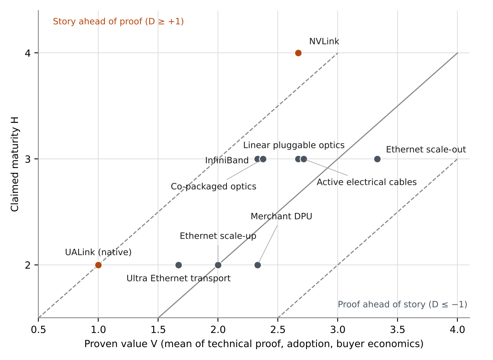
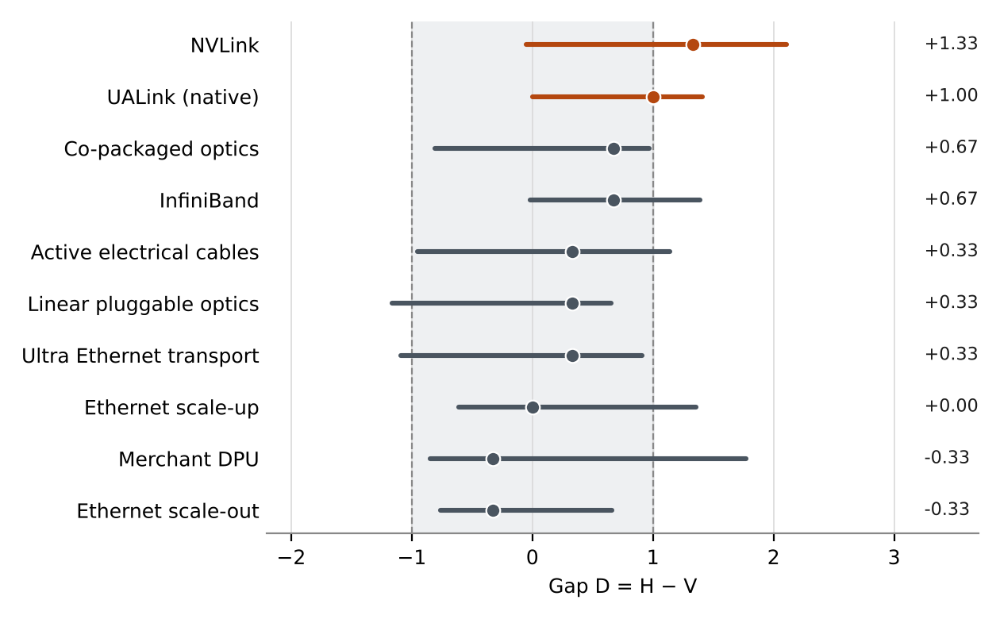

## Executive Summary

AI networking is now a first-order investment decision, yet the signals used to judge it disagree: analysts describe narrative maturity, equity research describes vendor revenue, and engineers describe power, reach and cost per bit. This project builds and applies the Hype-to-Value Divergence Index (HVDI), a tested instrument that scores ten interconnect technologies on what is claimed (H), what is technically proven (T), who has adopted it (A), how solid the money is (Q) and what buyers have gained (E). External constraints (X) sit outside the arithmetic as gates that no score can offset.

Using 152 public sources as of 11 November 2026, audited on 12 November, three technologies show a story ahead of their proof: native UALink (gap +2.00, the only firm verdict), Ultra Ethernet transport (+1.33) and Ethernet scale-up (+1.00, on the threshold). The other seven are broadly aligned and none has proof ahead of its story. No technology scores above 2 on buyer economics, because that evidence sits with buyers. All five gates constrain today and none blocks; a halt in indium exports would block the four optical technologies.

The proposed solution has three parts: the index itself as a reusable instrument, a set of decision rules (deploy, pilot, hold an option, defer, prove the baseline), and contract practices that buy the missing buyer-side proof. The index is a decision aid built from one coder's scores at one date. A back-test on earlier networking bets is the condition for calling it predictive.

## 1. Introduction

### 1.1 Background

The scale of AI infrastructure spending is settled. The four largest hyperscalers guide to roughly $720 to $740 billion of 2026 capital expenditure (forecast; secondary compilation, [[S32]]). Switch sales into AI back-end networks passed front-end networks for the first time in the second quarter of 2026 (estimate, [[S29]]). Hyperscalers sold more than $370.7 billion of bonds in 2026 to 4 November, about one-fifth of US investment-grade issuance (estimate, [[S57]]).

What is unsettled is which parts of the interconnect stack have earned their narrative. The exploratory phase showed how easily signals are mixed. The proposal's $15.4 billion market figure described all Ethernet switching, not data-center switching, and a widely quoted grid-queue total described generation projects, not data-center load ([[S01,S05]]).

### 1.2 Objective

The objective is to design the HVDI, test it, and apply it to the AI network hardware value chain. Four questions follow:

1. For each technology, how far does claimed maturity exceed or trail evidenced maturity?
2. Which evidence is missing: technical, adoption or buyer economics?
3. How solid is the capital behind each technology, and which external gates can block it regardless of readiness?
4. How stable are the verdicts when scores and weights are perturbed?

### 1.3 Scope and research matrix

The unit of analysis is technology by buyer type by generation by date. This report scores a hyperscale buyer on evidence available on 11 November 2026. Ten technologies are scored: Ethernet scale-out (800G, RoCEv2), InfiniBand scale-out, Ultra Ethernet transport, NVLink scale-up, native UALink scale-up, Ethernet scale-up (SUE, ESUN, UALink over Ethernet), merchant DPUs, co-packaged optics (CPO), linear pluggable optics (LPO) and active electrical cables (AEC). High-bandwidth memory and advanced packaging are treated as gates. GPU ranking and application-layer economics are out of scope. The 2025 to 2030 horizon holds observations to late 2026 and scenarios beyond. The research matrix, which maps each question to evidence, method and managerial output, is in Appendix 1.

## 2. Problem Statement

The managerial problem is specific: how should an infrastructure planner allocate investment across networking options when vendor narrative, capital, deployable infrastructure and workload value mature at different speeds?

Three features make the problem hard. First, the people who make claims and the people who hold the proof are different. Vendors announce; buyers measure, and rarely publish. This is information asymmetry in the classic sense ([[akerlof1970]]), and it means that a costly signal such as a binding purchase commitment carries more information than an announcement ([[spence1973]]). Second, collective expectations form around a technology before it works, and those expectations steer investment ([[borup2006,swanson1997]]); in Information Systems research, adoption that follows fashion rather than evidence is well documented ([[wang2010]]). Third, value depends on complements. A switch generation creates no value until power, packaging, memory and optics arrive with it ([[adner2010,teece1986]]).

The Information Systems literature frames the stake. IT spending becomes business value only through a chain of conversion, use and competitive process, and each link can fail ([[soh1995]]); alignment between technology choices and business strategy has to be managed, not assumed ([[henderson1993]]). The planner therefore needs an instrument that separates the claim from the proof, grades the proof by who holds it, and shows where a complement can block value. No public instrument for AI networking does this.

## 3. Methodology

### 3.1 Research approach and position against prior work

The project follows a design-science approach: it builds an artefact, the index, and evaluates it for rigour and usefulness ([[hevner2004]]). All data are public and secondary.

The Gartner Hype Cycle places a technology on one curve that blends visibility with maturity ([[fenn2008]]). Reviews find no stated measurement basis and unevenly spaced stages ([[steinert2010,dedehayir2016]]), and hype patterns differ by technology ([[vanlente2013]]). Readiness levels measure engineering maturity but not expectations ([[mankins2009]]).

Measuring the gap between expectation and maturity is not new. Kim et al. (2026) define a Maturity-Expectation Gap from expert surveys for generative AI in public R&D review. Choi and Geum (2025) quantify Hype Cycle technologies on technology, market and expectation dimensions. Cao et al. (2025) build a news-attention hype index for equities. The closest prior work is Kim et al.; the HVDI differs from it in four ways:

1. **Documented evidence, graded by who holds it.** A score of 3 or more requires proof from a buyer, an independent tracker or a filing. Vendor marketing alone stops at 2.
2. **Capital quality as its own measure.** Money is scored for how committed and how concentrated it is, and is never counted as proof.
3. **Non-compensatory gates.** A blocked gate overrides any score, following the ecosystem view of complements.
4. **A tested, reproducible instrument.** Scores, rules and sensitivity analysis are in code with automated tests.

These claims of novelty rest on a limited literature search and are provisional.

### 3.2 Parameters, index and verdict

Each technology receives an integer score from 0 to 4 on five parameters: claimed maturity (H), technical proof (T), adoption (A), capital quality (Q) and buyer economics (E). The rubric for every level is in Appendix 2. The sixth parameter, X, is a set of five gates: site power and grid, advanced packaging, high-bandwidth memory, indium phosphide lasers and export policy. Each gate is open, constraining or blocked, and applies only to the technologies exposed to it.

Proven value is V = wT·T + wA·A + wE·E, and the gap is D = H − V. Equal weights are the baseline, following the composite-indicator sequence of framework, indicators, weighting and sensitivity ([[S21]]). D of +1.0 or more means the story is ahead; −1.0 or less means the proof is ahead; between the two, the technology is broadly aligned. One rubric level is the threshold because it is the smallest step a coder can distinguish. Q is reported beside the gap and is never subtracted from it.

An outlook label is derived by a transparent rule: a dated milestone within twelve months that addresses the weakest evidence leg, whether the last milestone arrived on time, and capital quality. A blocked gate overrides the sum. The rule has not been calibrated against outcomes.

### 3.3 Data collection

The evidence base is 152 logged sources, of which 71 carry scores in the dataset. Source classes, in descending order of weight, are regulatory filings, standards documents, peer-reviewed and conference papers, originating analyst releases, vendor documents and secondary reports (Appendix 3). A number is used only with a named publisher, date, period, unit and denominator, and is labelled as an observed result, an estimate, a specification or a forecast. Missing evidence is recorded as missing, never as zero.

On 12 November 2026 the 18 weakest evidence cells were re-researched and the key filings were read at origin: Arista's and NVIDIA's 10-Q, AMD's 8-K and 10-Q, Credo's 10-K and 10-Q, Astera Labs' results, the Ultra Ethernet 1.1 specification and Meta's deployment slides for linear optics and active cables. Two scores moved, both upward (Section 4.1). Gartner's Hype Cycle positions were not accessed, so H uses this study's rubric and says nothing about Gartner's placement. Paid analyst tables were not read.

### 3.4 Data analysis and testing

Each verdict is recomputed under three alternative weightings and under a 20,000-draw Monte Carlo test. Weights are drawn from a Dirichlet distribution centred on equal weights, and each score shifts one level up or down with probability 0.15, 0.30 or 0.45 for high, medium or low confidence. Stability is the share of draws that keep the baseline verdict. Four scenarios stress the gates. Two bounded models replace cost per bit, which cannot be computed from public prices.

The engine has 43 automated tests: exhaustive bounds and monotonicity over every score combination, threshold edges, gate override, hand-calculated energy and break-even values, data integrity, the evidence-admission rule, input validation and Monte Carlo reproducibility. Regression was set aside, because ten technologies at one date cannot support causal inference.

## 4. Analysis and Findings

### 4.1 Scores and robustness

Three technologies are scored as story ahead of proof, seven as broadly aligned and none as proof ahead (Table 1, Figure 1).

**Table 1.** *HVDI scores at 11 November 2026, equal weights*

| Technology | H | T | A | Q | E | V | D | Verdict | Stability | Outlook |
| --- | --- | --- | --- | --- | --- | --- | --- | --- | --- | --- |
| UALink scale-up (native) | 3 | 1 | 1 | 1 | 1 | 1.00 | +2.00 | Story ahead | 99% | Stalling |
| Ultra Ethernet transport | 3 | 2 | 2 | 2 | 1 | 1.67 | +1.33 | Story ahead | 74% | Closing |
| Ethernet scale-up | 3 | 3 | 2 | 2 | 1 | 2.00 | +1.00 | Story ahead | 51% | Closing |
| Merchant DPU | 3 | 3 | 2 | 2 | 2 | 2.33 | +0.67 | Aligned | 67% | Holding |
| Ethernet scale-out | 4 | 4 | 4 | 3 | 2 | 3.33 | +0.67 | Aligned | 81% | Holding |
| Co-packaged optics | 3 | 3 | 2 | 2 | 2 | 2.33 | +0.67 | Aligned | 73% | Holding |
| NVLink scale-up | 3 | 3 | 4 | 2 | 1 | 2.67 | +0.33 | Aligned | 78% | Holding |
| InfiniBand scale-out | 2 | 3 | 3 | 2 | 1 | 2.33 | −0.33 | Aligned | 81% | Holding |
| Linear pluggable optics | 2 | 3 | 3 | 2 | 2 | 2.67 | −0.67 | Aligned | 71% | Holding |
| Active electrical cables | 2 | 3 | 3 | 2 | 2 | 2.67 | −0.67 | Aligned | 64% | Holding |

*Note.* Stability is the share of 20,000 Monte Carlo draws that keep the verdict. Evidence for every score is in Appendix 4.

Under the three alternative weightings, eight verdicts do not change. Ethernet scale-out becomes story ahead when buyer economics carries half the weight (D = +1.00), and Ethernet scale-up becomes aligned when technical proof does (D = +0.75). The 90% interval for UALink's gap is +1.00 to +3.00, entirely on the story-ahead side; for every other technology the interval crosses a threshold (Figure 2). The honest reading is one firm verdict and nine directional ones. Ethernet scale-up, at exactly +1.00, is close to a coin toss.

The audit moved two scores. Ethernet scale-up technical proof rose from 2 to 3 because Meta states that its Tahan Ethernet scale-up switch is shipping ([[S124]]). Merchant-DPU buyer economics rose from 1 to 2 because Google reports host cores freed against on-host baselines on a co-designed device ([[S136]]); the one independent merchant-DPU baseline is unfavourable to offload ([[S112]]).

### 4.2 The open scale-up story is ahead of its proof

Native UALink has the largest and firmest gap. A 2.0 specification was published in April 2026 before any 1.0 silicon shipped ([[S33]]), and its performance targets rest on modelling and simulation ([[S34]]). AMD's first Helios racks run their scale-up domain over UALink-over-Ethernet on Broadcom silicon because native UALink switch chips are still in validation ([[S63,S98]]). Astera Labs, a named UALink supplier, reports record revenue but discloses no UALink revenue ([[S150]]).

That one fact explains two outlooks. UALink is likely to stall: its last milestone slipped and its capital is venture money. Ethernet scale-up is likely to close its gap: racks are shipping, Meta's switch is shipping, and Broadcom said on its September call that Tomahawk Ultra began deployment in its current quarter ([[S68]]). NVLink, the incumbent, is aligned and still dominates scale-up deployments ([[S65]]). A buyer choosing 2026 racks could not buy the native open alternative.

### 4.3 A compliance label is not a deployed transport

Ultra Ethernet transport scores D = +1.33. The specification reached version 1.1 in October 2026 and compliant NICs are announced, and one buyer, Oracle, has stated an intent to deploy them ([[S72,S78]]). Compliance is self-attested under the specification's own rules, with no published test-lab result ([[S73]]), and the consortium's test-bed guidance leaves interoperation and performance testing out of scope ([[S152]]). A vendor-sponsored report still described the transport in April 2026 as emerging, with RoCEv2 the working choice in hyperscale fabrics ([[S71]]).

### 4.4 Buyer economics is the weakest proof everywhere

No technology scores above 2 on buyer economics, including Ethernet scale-out, which scores 4 on technical proof and adoption ([[S10,S29]]). Public sources show that buyers deploy and expand; they do not show matched-baseline cost, energy or downtime. Meta reports parity, not benefit, between its RoCE and InfiniBand clusters ([[S87]]).

A bounded model shows why this gap matters. If the network is 15% of cluster cost, a network priced 20% higher raises total cost by 3.0%, and pays for itself if useful output rises by 3.0%. Small utilization gains justify large premiums, and nobody outside the buyer can verify the gain.

### 4.5 Real revenue, few payers

Nine of ten technologies score 2 or less on capital quality. Only Ethernet scale-out reaches 3: Arista's 10-Q shows remaining performance obligations of about $8.6 billion and deferred revenue of $6.84 billion, both owed by buyers, against $3.66 billion of quarterly revenue ([[S139,S30]]). Its $11.4 billion of purchase commitments are owed to its own suppliers, so they show vendor confidence, not buyer commitment.

Elsewhere, revenue rests on few payers. Credo's two largest customers were 43% and 28% of revenue in the quarter to 1 August 2026, and 81% together in fiscal 2026 ([[S147,S142]]). NVIDIA's three largest direct customers were 44% of first-half fiscal 2027 revenue ([[S54]]). AMD's binding 1 GW commitment from Meta comes with a warrant for up to 160 million shares, and it is for GPUs, not the scale-up fabric ([[S140,S141]]). Buyers also lean on external funding: third-quarter capital expenditure was 182% of operating cash flow at Amazon, 122% at Alphabet and 103% at Meta (secondary compilation, [[S32]]). Concentration is not hype, but a single buyer's pause would change the picture faster than any technical event.

### 4.6 Quieter technologies are not over-told

InfiniBand, linear pluggable optics and active electrical cables all have a negative gap. InfiniBand sales more than tripled in the first quarter of 2026 against a narrative of decline ([[S11]]). Meta reports, from about 4,000 linear modules on one fabric hop over four months, roughly 2 times fewer link interruptions and 2.6 times fewer service-affecting failures than retimed optics ([[S137]]). Its 800G cable slides describe fleet use with three qualified suppliers, and failures that appeared only at cluster scale ([[S148]]). Each is one operator's account, not independent replication.

Co-packaged optics is closer to aligned than its reputation. Meta's evaluation logged one million flap-free port-hours, and a follow-up reported about 65% lower optics power ([[S66]]); initial deployments arrived in 2026, as analysts had forecast ([[S37,S36]]). The evidence is from the 51.2 Tb/s generation, and adoption remains the weak leg.

### 4.7 Constraints are real but not yet blocking

All five gates are constraining and none is blocked (Appendix 5). Grid-connection waits exceed four years in primary US markets ([[S62]]), advanced-packaging supply ran about 20% short of demand in mid-2026 ([[S60]]), one supplier's HBM4 ramp slipped a quarter ([[S43]]), a leading indium phosphide laser supplier ships about 30% below demand ([[S61]]), and certain AI chips need case-by-case export licences ([[S59]]). Interconnect readiness is not what limits value in late 2026; delivered capacity, packaging, memory and lasers are.

The scenarios show a structural asymmetry. A halt in indium exports blocks the four optical technologies and leaves the six copper or protocol technologies untouched. A Taiwan packaging disruption, tighter export rules or worse grid delays block all ten. These are exposure tests and predict nothing.

### 4.8 Energy per bit depends on the boundary

Rated switch energy per bit fell about 4.7 times across four generations of Tomahawk-based systems, from 58.4 to 12.5 picojoules per bit at typical load without optics ([[S46,S47,S48,S49]]). The boundary changes the answer more than the generation does: the same Tomahawk 5 switch reads 12.5 pJ/bit with copper cables and 43.3 at maximum load with optics ([[S49]]). A linear 800G module is rated 7.5 W below a retimed one ([[S51,S50]]). At $0.08 per kWh, a facility overhead of 1.2 and a four-year life, that saving is worth $25.23 per module in energy; if freed site capacity is valued at $8 per watt, it adds $72.00. The inputs are illustrative, not sourced prices. The structural point is that the case for linear optics rests on freed capacity and reliability, not on electricity. All values are vendor-rated, not measured in operation.

The eight hypotheses from the proposal are assessed in Appendix 6: four are supported, one is indeterminate and three could not be tested with public data.

## 5. Proposed Solutions

### 5.1 The index as a reusable instrument

The first solution is the instrument itself. A planning team that adopts the HVDI gains a common language for a decision that is usually argued by anecdote: a score, the evidence behind it, who holds that evidence, and how sensitive the verdict is. Because the rule that vendor-only evidence stops at 2 is enforced in code, the index cannot be moved by a press release. Because gates sit outside the arithmetic, strong adoption cannot mask a supply constraint.

### 5.2 Decision rules for infrastructure planners

The second solution converts verdicts into postures (Table 2). Each posture states the evidence that would move a technology up.

**Table 2.** *Decision rules and current assignments*

| Posture | Condition | Technologies today | Require before moving up |
| --- | --- | --- | --- |
| Deploy | Aligned; T and A at 3 or more | Ethernet scale-out, NVLink, InfiniBand, LPO, AEC | Supply assurance; matched-baseline economics in the contract |
| Pilot at scale | Aligned; A at 2 | Co-packaged optics | Reliability data for the generation being bought; pluggable fallback |
| Hold an option | Story ahead; outlook closing | Ethernet scale-up, Ultra Ethernet transport | Hardware that can carry the standard; no commissioning date tied to it |
| Defer | Story ahead; outlook stalling | Native UALink | Switch silicon sampled, then multi-vendor interoperability |
| Prove the baseline | Aligned; E shown only on co-designed hardware | Merchant DPU | A host-only comparison on the buyer's own workload |

### 5.3 Buy the missing proof

The third solution addresses the weakest leg directly. Since buyer economics is the missing evidence everywhere, the buyer should purchase it:

1. **Matched-baseline measurement in the contract.** Specify the baseline, the workload and the metric (job completion time, link interruptions, watts per port) before deployment, and make acceptance depend on it.
2. **Schedule by gate, not by product.** Plan around time to energized capacity and component allocation, since those gates constrain every technology.
3. **Diversify the medium.** Copper-based links are insulated from the laser-material risk that gates all four optical technologies; a design that can substitute cables for optics at short reach reduces exposure.
4. **Treat concentration as a supply risk.** Where two customers supply most of a vendor's revenue, ask for capacity reservations and second sources.

### 5.4 Guidance for other stakeholders

For silicon investors, revenue is earned mainly in the aligned technologies. Story-ahead technologies behave like options tied to dated milestones, so slippage is the signal to watch, and capital quality (customer concentration, vendor financing, deferred revenue) can move reported results without any change in the technology. The index says nothing about valuation and is not investment advice. For capacity policymakers, the binding constraint in late 2026 is delivered capacity, and interconnection-queue totals overstate data-center demand because they describe generation projects ([[S05]]). The scenarios identify where exposure is concentrated: advanced packaging in one geography and a laser material under export control.

## 6. Implementation Suggestions

### 6.1 Putting the index to work

A planning team can adopt the instrument in five steps.

1. **Fix the unit.** Choose the buyer type, generation and date, since a score for a hyperscaler does not transfer to an enterprise buyer.
2. **Score independently.** Two analysts score every cell from the evidence ledger and report an agreement statistic before any result is used.
3. **Run the engine.** The code recomputes gaps, robustness and scenarios and fails its tests if a score lacks admissible evidence.
4. **Assign postures and triggers.** Each technology gets a posture from Table 2 and one observable event that would change a score, such as native UALink silicon sampling or a second named CPO buyer at 102.4 Tb/s.
5. **Refresh quarterly, and on triggers.** Earnings filings and standards releases arrive on a quarterly rhythm, which sets the cadence.

### 6.2 Implementation artefact

The deliverable is a working instrument: the dataset, the tested engine and an interactive page on which a reader selects a technology, an evidence weighting and a stress scenario. The page is self-contained and is public at {{SITE_URL}}. The code, dataset and tests are in a private repository at {{CODE_URL}}, with access granted to evaluators on request.

### 6.3 Execution plan, challenges and roadblocks

The work ran in three windows: topic selection and proposal in September 2026; an exploratory dossier with a claim audit and index design by 16 October; and the full model, engine, scoring, scenarios, page, report and deck by 11 November, followed by the evidence audit on 12 November (Appendix 7).

Four roadblocks shaped the method. Paid analyst tables were not accessible, so public releases were used for direction and no market share was computed. Gartner's positions were unavailable, so the study uses its own rubric. No transaction prices are public, so cost per gigabit could not be computed and two bounded models replace it. The planned regression was dropped because ten technologies at one date cannot support it.

### 6.4 Limitations and next steps

1. One coder assigned every score. Monte Carlo stability shows sensitivity to coding error; it does not replace a second coder.
2. One date. The index cannot yet show whether a gap is closing.
3. Any pre-production technology shows a positive gap. That marks timing risk, not a flawed technology.
4. Nine of ten verdicts are directional only.
5. The outlook rule is uncalibrated, and the scenarios test exposure, not likelihood.
6. Capital quality is observed at company level and attached to technologies by judgement.
7. Some sources were read as excerpts, and operator results reached the study partly through second-hand accounts ([[S120,S39]]).

Each finding has a stated falsifier in the evidence audit; for example, a published Ultra Ethernet plugfest result would lift its technical score, and a UALink revenue line in a supplier's filing would lift its capital score. The next steps are a second coder, a frozen corpus of claims, a quarterly panel, and a back-test on earlier networking bets such as 400G, software-defined networking and SmartNICs. That back-test is the condition for calling the index predictive.
