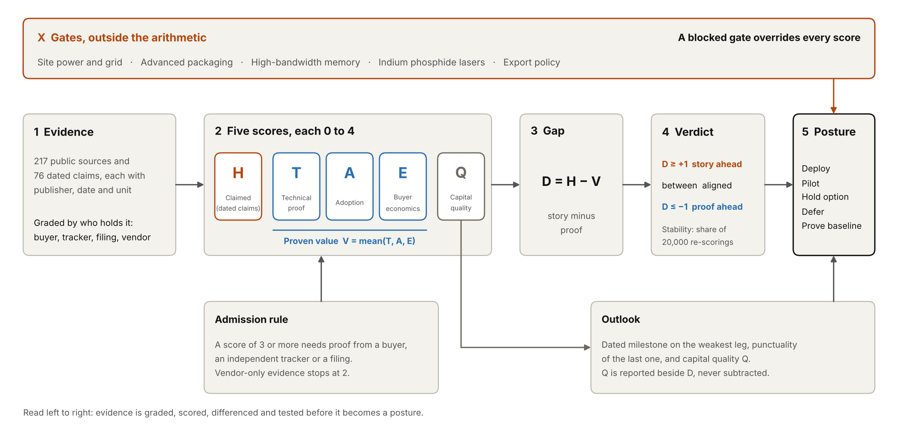
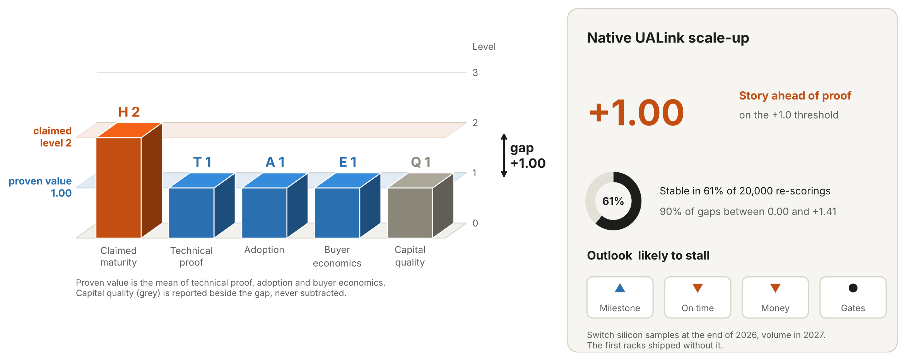
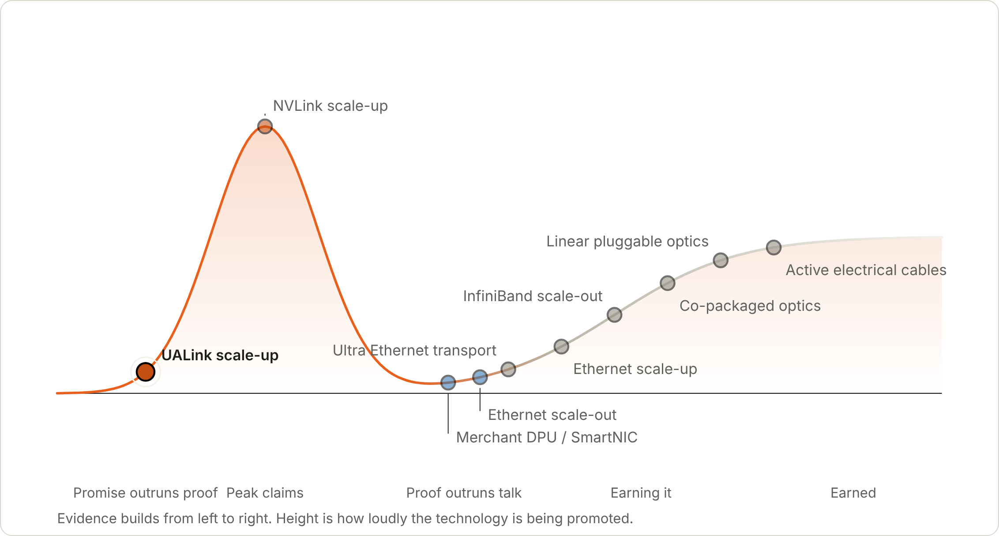
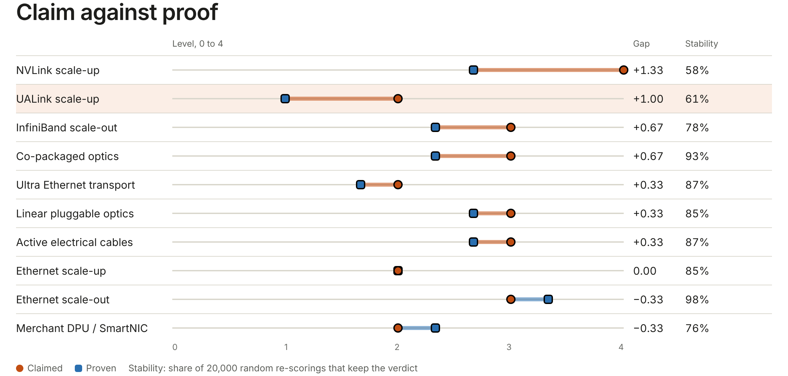
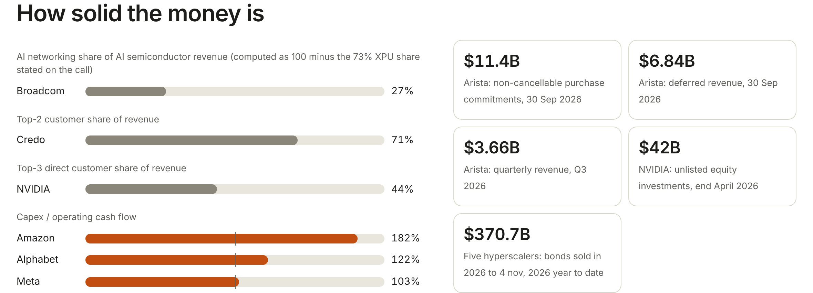
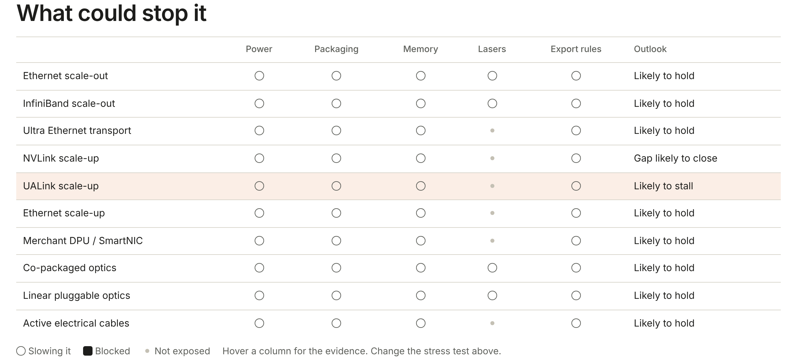
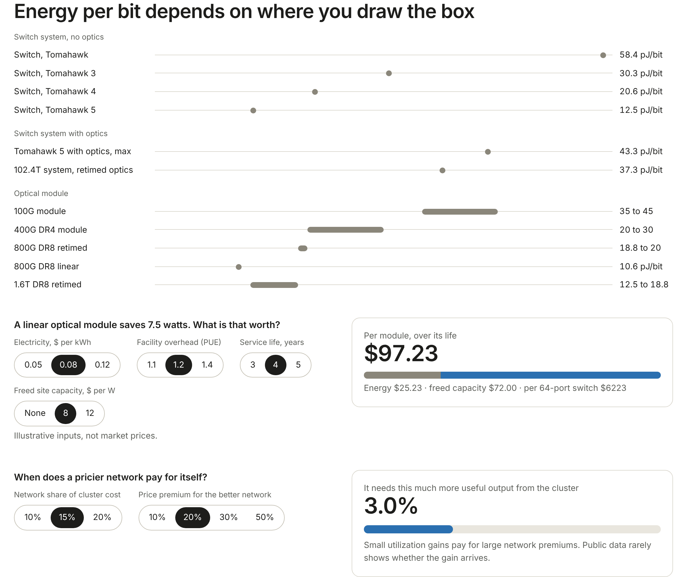

## Executive Summary

AI networking is now a first-order investment decision, yet the signals used to judge it disagree. Analysts describe narrative maturity, equity research describes vendor revenue, and engineers describe power, reach and cost per bit. This project builds the Hype-to-Value Divergence Index (HVDI), a tested instrument that scores ten interconnect technologies on what is claimed (H), technically proven (T), adopted (A) and gained by buyers (E), with capital quality (Q) reported alongside. External constraints sit outside the arithmetic as gates that no score can offset. The evidence base is 218 public sources and 76 dated claims as of 11 November 2026, and a reader's guide to every symbol opens the appendices. Three takeaways follow.

1. **Two stories run ahead of their proof.** NVLink (gap +1.33) and native UALink (+1.00, on the threshold) are story ahead, each holding in about three of five re-scorings. The other eight are broadly aligned, and blind second codings by an AI model and by five human coders reproduced all ten verdicts.
2. **Buyer economics is the missing proof.** No technology scores above 2 on what buyers have gained, because that evidence sits with buyers, not vendors.
3. **Constraints bind outside the stack.** All five gates constrain today and none blocks, although a halt in indium exports would block the four optical technologies.

For planners the index becomes decision rules. Deploy where proof is solid, such as Ethernet scale-out, deploy NVLink while verifying its economics, pilot co-packaged optics and Ultra Ethernet at scale, defer native UALink until switch silicon samples, and write matched-baseline measurement into contracts to buy the missing proof. The index is a decision aid built from one coder's scores at one date. An exploratory back-test on 400G Ethernet and OpenFlow suggested that the gap's direction over time separates success from stall, and identified three refinements toward stronger predictive power (Appendix 11).

## 1. Introduction

### 1.1 Background

In late 2026 the first AI racks built around an open scale-up standard shipped without the fabric they were named for. The standard had a specification, a consortium and a second version, but it did not yet have a switch chip. That distance between the story told and the product delivered is the subject of this project.

The scale of AI infrastructure spending is settled. The four largest hyperscalers guide to roughly $720 to $740 billion of 2026 capital expenditure (forecast, secondary compilation, [[S32]]). Switch sales into AI back-end networks passed front-end networks for the first time in the second quarter of 2026 (estimate, [[S29]]). Hyperscalers sold more than $370.7 billion of bonds in 2026 to 4 November, about one-fifth of US investment-grade issuance (estimate, [[S57]]).

What is unsettled is which parts of the interconnect stack have earned their narrative. The exploratory phase showed how easily signals are mixed. The proposal's $15.4 billion market figure described all Ethernet switching, not data-center switching, and a widely quoted grid-queue total described generation projects, not data-center load ([[S01,S05]]).

### 1.2 Objective

The objective is to design the HVDI, test it, and apply it to the AI network hardware value chain. Four questions follow.

1. For each technology, how far does claimed maturity exceed or trail evidenced maturity?
2. Which evidence is missing, technical, adoption or buyer economics?
3. How solid is the capital behind each technology, and which external gates can block it regardless of readiness?
4. How stable are the verdicts when scores and weights are perturbed?

### 1.3 Scope and research matrix

The unit of analysis is technology by buyer type by generation by date. This report scores a hyperscale buyer on evidence available on 11 November 2026. Ten technologies are scored, namely Ethernet scale-out (800G, RoCEv2), InfiniBand scale-out, Ultra Ethernet transport, NVLink scale-up, native UALink scale-up, Ethernet scale-up (SUE, ESUN, UALink over Ethernet), merchant DPUs, co-packaged optics (CPO), linear pluggable optics (LPO) and active electrical cables (AEC). High-bandwidth memory and advanced packaging are treated as gates. GPU ranking and application-layer economics are out of scope. The 2025 to 2030 horizon holds observations to late 2026 and scenarios beyond. The research matrix, which maps each question to evidence, method and managerial output, is in Appendix 1.

## 2. Problem Statement

The managerial problem is specific. How should an infrastructure planner allocate investment across networking options when vendor narrative, capital, deployable infrastructure and workload value mature at different speeds?

Three features make the problem hard. First, the people who make claims and the people who hold the proof are different. Vendors announce, while buyers measure and rarely publish. This is information asymmetry in the classic sense ([[akerlof1970]]), and it means that a costly signal such as a binding purchase commitment carries more information than an announcement ([[spence1973]]). Second, collective expectations form around a technology before it works, and those expectations steer investment ([[borup2006,swanson1997]]). In Information Systems research, adoption that follows fashion rather than evidence is well documented ([[wang2010]]). Third, value depends on complements. A switch generation creates no value until power, packaging, memory and optics arrive with it ([[adner2010,teece1986]]).

The Information Systems literature frames the stake. IT spending becomes business value only through a chain of conversion, use and competitive process, and each link can fail ([[soh1995]]). Alignment between technology choices and business strategy has to be managed, not assumed ([[henderson1993]]). The planner therefore needs an instrument that separates the claim from the proof, grades the proof by who holds it, and shows where a complement can block value. No public instrument for AI networking does this.

## 3. Methodology

### 3.1 Research approach and position against prior work

The project follows a design-science approach. It builds an artefact, the index, and evaluates it for rigour and usefulness ([[hevner2004]]). All data are public and secondary.

The Gartner Hype Cycle places a technology on one curve that blends visibility with maturity ([[fenn2008]]). Reviews find no stated measurement basis and unevenly spaced stages ([[steinert2010,dedehayir2016]]), and hype patterns differ by technology ([[vanlente2013]]). Readiness levels measure engineering maturity but not expectations ([[mankins2009]]).

Measuring the gap between expectation and maturity is not new. Kim et al. (2026) define a Maturity-Expectation Gap from expert surveys for generative AI in public R&D review. Choi and Geum (2025) quantify Hype Cycle technologies on technology, market and expectation dimensions. Cao et al. (2025) build a news-attention hype index for equities. The closest prior work is Kim et al., and the HVDI differs from it in four ways.

1. **Documented evidence, graded by who holds it.** A score of 3 or more requires proof from a buyer, an independent tracker or a filing. Vendor marketing alone stops at 2.
2. **Capital quality as its own measure.** Money is scored for how committed and how concentrated it is, and is never counted as proof.
3. **Non-compensatory gates.** A blocked gate overrides any score, following the ecosystem view of complements.
4. **A tested, reproducible instrument.** Scores, rules and sensitivity analysis are in code with automated tests.

These claims of novelty rest on a limited literature search and are provisional.

### 3.2 The HVDI framework

Figure 1 shows the framework in one view. It has five steps and two side rules.

**Step 1, evidence.** Every claim enters a ledger with its publisher, date, period and unit, and is graded by who holds it, whether a buyer, an independent tracker, a regulatory filing or a vendor.

**Step 2, five scores.** Each technology receives an integer from 0 to 4 on claimed maturity (H), technical proof (T), adoption (A), buyer economics (E) and capital quality (Q). The rubric for every level is in Appendix 2. The admission rule governs this step. A score of 3 or more needs buyer, tracker or filing evidence, and vendor marketing alone stops at 2.

**Measuring claimed maturity.** H is the only parameter that measures a story rather than a proof, so it is the one most exposed to a coder's own reading, and a first blind check confirmed this (Section 6.4). H is therefore scored from a corpus of dated public claims made between 12 November 2025 and 11 November 2026 by promoters, vendors, originating analysts and named people quoted in the press (Appendix 9). A stage claim asserts what deployment stage a technology has reached, whereas a narrative claim frames its momentum or destiny, such as "the eventual winner" or "a premature launch". Both are coded from 0 to 4 (Appendix 2), so a confident forecast of dominance counts as strong hype even though it concerns the future. For each kind, the level is the highest that a strict majority of claims reach, and H is the higher of the two, because a buyer hears the loudest credible story. A narrative level counts only with at least two claims, so that no single editorial sets H.

**Step 3, the gap.** Proven value is V = wT·T + wA·A + wE·E, and the gap is D = H − V. Equal weights are the baseline, following the composite-indicator sequence of framework, indicators, weighting and sensitivity ([[S21]]).

**Step 4, the verdict.** D of +1.0 or more means the story is ahead, and −1.0 or less means the proof is ahead. Between the two, the technology is broadly aligned. One rubric level is the threshold because it is the smallest step a coder can distinguish. Each verdict carries a stability figure from the robustness test in Section 3.4.

**Step 5, the posture.** The verdict, an outlook label and the gates together give a posture (Section 5.2). The outlook comes from a transparent rule that weighs a dated milestone within twelve months that addresses the weakest evidence leg, whether the last milestone arrived on time, and capital quality. The rule has not been calibrated against outcomes.

**Two side rules.** Capital quality (Q) is reported beside the gap and never subtracted from it, because money is not proof. The gates (X) sit outside the arithmetic. They are site power and grid, advanced packaging, high-bandwidth memory, indium phosphide lasers and export policy. Each is open, constraining or blocked, applies only to the technologies exposed to it, and overrides every score when blocked.

**A worked example.** Native UALink is the open alternative to NVLink. Stage claims place the first switches later in 2026 and its narrative is mostly sceptical, from "a premature launch" to switches that "simply aren't ready" ([[S170,S172,S171,S214]]), so H is 2. Targets rest on simulation (T = 1), no product carries a native switch (A = 1) and no buyer has reported a benefit (E = 1). The gap is therefore +1.00, exactly on the threshold and kept by 61% of re-scorings (Figure 2). With venture capital (Q = 1) and a slipped milestone, the outlook is stalling and the posture is to defer until switch silicon samples.

### 3.3 Data collection

The evidence base is 217 logged sources, of which 116 carry scores in the dataset, including the 76 dated claims behind H. Source classes, in descending order of weight, are regulatory filings, standards documents, peer-reviewed and conference papers, originating analyst releases, vendor documents and secondary reports (Appendix 3). A number is used only with a named publisher, date, period, unit and denominator, and is labelled as an observed result, an estimate, a specification or a forecast. Missing evidence is recorded as missing, never as zero.

On 12 November 2026 the 18 weakest evidence cells were re-researched and the key filings were read at origin, including filings from Arista, NVIDIA, AMD and Credo, Astera Labs' results, the Ultra Ethernet 1.1 specification and Meta's deployment slides. Two scores moved, both upward (Section 4.1). Gartner's Hype Cycle positions were not accessed, so H uses this study's rubric and says nothing about Gartner's placement. Paid analyst tables were not read.

### 3.4 Data analysis and testing

Each verdict is recomputed under three alternative weightings and under a 20,000-draw Monte Carlo test. Weights are drawn from a Dirichlet distribution centred on equal weights, and each score shifts one level up or down with probability 0.15, 0.30 or 0.45 for high, medium or low confidence. Stability is the share of draws that keep the baseline verdict. Four scenarios stress the gates. Two bounded models replace cost per bit, which cannot be computed from public prices.

For H the test resamples the claims themselves. Each draw takes the claims with replacement, gives any claim the coder marked as torn between two levels either level with equal chance, and recomputes H by the rule.

The engine has 64 automated tests covering bounds and monotonicity over every score combination, thresholds, gate override, hand-calculated energy and break-even values, data integrity, the admission rule and Monte Carlo reproducibility. Regression was set aside, because ten technologies at one date cannot support causal inference.

## 4. Analysis and Findings

The findings follow the framework's own order, from the gap to the leading stories, the weakest evidence leg, the money, the under-told technologies, the gates and energy.

### 4.1 Finding 1. Once hype is measured from dated claims, only two stories run ahead of their proof

Two technologies are scored as story ahead of proof, eight as broadly aligned and none as proof ahead (Figures 3 and 4, Table A4.1).

*Note.* Stability is the share of 20,000 draws, resampling claims and scores, that keep the verdict. Evidence for every score is in Appendix 4, and the claims behind H are in Appendix 9.

The first is the incumbent. NVIDIA's chief executive told investors that most of the world's data centres "will just be Vera Rubin NVLink-72" ([[S86]]), and an analyst wrote of NVLink's "inevitable momentum" as the dominant fabric ([[S196]]). Its technical proof and adoption are strong, but no buyer has published its economics, so the story outruns the proof by 1.33. The second is native UALink, exactly on the threshold.

The public record is more restrained than its reputation. Vendors claim shipping, sampling or adoption, and it is mostly analysts who call a technology the default. Co-packaged optics, often cited as the archetype of optical hype, is aligned once its narrative is read in full. The most bullish analyst article also calls it a "plaything" for hyperscale clusters until 2028 ([[S199]]).

Under the three alternative weightings, nine verdicts do not change, and InfiniBand becomes story ahead when buyer economics carries half the weight (D = +1.00). For eight technologies the 90% interval of the gap crosses a threshold (Figure 5). Only Ethernet scale-out and co-packaged optics stay aligned across it, so eight verdicts are directional. A blind second coding of the 76 claims gave the same verdict for all ten technologies (Section 6.4).

The 12 November audit moved two proof scores. Ethernet scale-up technical proof rose from 2 to 3 because Meta states that its Tahan scale-up switch is shipping ([[S124]]). Merchant-DPU buyer economics rose from 1 to 2 because Google reports host cores freed on a co-designed device ([[S136]]), whereas the one independent merchant-DPU baseline is unfavourable to offload ([[S112]]).

*For the planner.* Treat NVLink's lead as a pricing and lock-in question rather than a technical one, and treat UALink's verdict as unsettled.

### 4.2 Finding 2. The open scale-up story has narrowed to one technology

Native UALink is the only open scale-up option whose story still runs ahead of its proof, and only just. A 2.0 specification was published in April 2026 before any 1.0 silicon shipped ([[S33]]), and its performance targets rest on modelling and simulation ([[S34]]). AMD's first Helios racks run their scale-up domain over UALink-over-Ethernet on Broadcom silicon because native UALink switch chips are still in validation ([[S63,S98]]). Astera Labs, a named UALink supplier, reports record revenue but discloses no UALink revenue ([[S150]]).

UALink's outlook is stalling, as its last milestone slipped and its capital is venture money. Ethernet scale-up, which an earlier version of this index placed ahead of its proof, is aligned once its claims are counted. Racks and Meta's switch are shipping, and Broadcom said Tomahawk Ultra began deployment in its September quarter ([[S68]]), while promoters claim no more than that. NVLink still dominates scale-up deployments ([[S65]]). A buyer choosing 2026 racks could not buy the native open alternative.

*For the planner.* Defer native UALink, and pilot Ethernet scale-up without tying a commissioning date to it.

### 4.3 Finding 3. The transport's promoters claim less than its critics assume

Ultra Ethernet transport is aligned (D = +0.33). The specification reached version 1.1 in October 2026 and compliant NICs are announced, and one buyer, Oracle, has stated an intent to deploy them ([[S72,S78]]). Compliance is self-attested under the specification's own rules, with no published test-lab result ([[S73]]), and the consortium's test-bed guidance leaves interoperation and performance testing out of scope ([[S152]]). The consortium made no public deployment claim in the window, and a vendor-sponsored report still described the transport in April 2026 as emerging, with RoCEv2 the working choice ([[S71]]). Its gap looked large when coverage was mistaken for claims.

*For the planner.* Buy hardware that can carry the standard, and ask for an interoperability result before relying on it.

### 4.4 Finding 4. Buyer economics is the weakest proof everywhere

No technology scores above 2 on buyer economics, including Ethernet scale-out, which scores 4 on technical proof and adoption ([[S10,S29]]). Public sources show that buyers deploy and expand, but they do not show matched-baseline cost, energy or downtime. Meta reports parity, not benefit, between its RoCE and InfiniBand clusters ([[S87]]).

A bounded model shows why this gap matters. If the network is 15% of cluster cost, a network priced 20% higher raises total cost by 3.0%, and pays for itself if useful output rises by 3.0%. Small utilization gains justify large premiums, and nobody outside the buyer can verify the gain.

*For the planner.* The missing proof has to be bought, and Section 5.3 shows how to write it into the contract.

### 4.5 Finding 5. The revenue is real, but it rests on few payers

Nine of ten technologies score 2 or less on capital quality. Only Ethernet scale-out reaches 3. Arista's 10-Q shows remaining performance obligations of about $8.6 billion and deferred revenue of $6.84 billion, both owed by buyers, against $3.66 billion of quarterly revenue ([[S139,S30]]).

Elsewhere, revenue rests on few payers. Credo's two largest customers were 43% and 28% of revenue in the quarter to 1 August 2026, and 81% together in fiscal 2026 ([[S147,S142]]). NVIDIA's three largest direct customers were 44% of first-half fiscal 2027 revenue ([[S54]]). Buyers also lean on external funding, with third-quarter capital expenditure above operating cash flow at Amazon, Alphabet and Meta (Figure 6, [[S32]]). Concentration is not hype, but a single buyer's pause would change the picture faster than any technical event.

*For the planner.* Read supplier concentration as a supply risk, and ask for capacity reservations and second sources.

### 4.6 Finding 6. The quieter technologies are not over-told

InfiniBand, linear pluggable optics and active electrical cables are aligned, with small positive gaps. InfiniBand sales more than tripled in the first quarter of 2026 against a narrative of decline ([[S11]]). Meta reports, from about 4,000 linear modules on one fabric hop over four months, roughly 2 times fewer link interruptions and 2.6 times fewer service-affecting failures than retimed optics ([[S137]]). Its 800G cable slides describe fleet use with three qualified suppliers, and failures that appeared only at cluster scale ([[S148]]). Each is one operator's account, not independent replication.

Co-packaged optics is closer to aligned than its reputation. Meta's evaluation logged one million flap-free port-hours, and a follow-up reported about 65% lower optics power ([[S66]]), and initial deployments arrived in 2026, as analysts had forecast ([[S37,S36]]). The evidence is from the 51.2 Tb/s generation, and adoption remains the weak leg.

*For the planner.* The under-told technologies are deployable now, and co-packaged optics merits a pilot at scale with a pluggable fallback.

### 4.7 Finding 7. Constraints outside the stack are real but not yet blocking

All five gates are constraining and none is blocked (Appendix 5). Grid-connection waits exceed four years in primary US markets ([[S62]]), advanced-packaging supply ran about 20% short of demand in mid-2026 ([[S60]]), one supplier's HBM4 ramp slipped a quarter ([[S43]]), a leading indium phosphide laser supplier ships about 30% below demand ([[S61]]), and certain AI chips need case-by-case export licences ([[S59]]). Interconnect readiness is not what limits value in late 2026. Delivered capacity, packaging, memory and lasers are.

The scenarios show a structural asymmetry. A halt in indium exports blocks the four optical technologies and leaves the six copper or protocol technologies untouched. A Taiwan packaging disruption, tighter export rules or worse grid delays block all ten. These are exposure tests and predict nothing.

*For the planner.* Schedule by gate, not by product, and keep a copper path where reach allows.

### 4.8 Finding 8. Energy per bit depends on where the boundary is drawn

Rated switch energy per bit fell about 4.7 times across four generations of Tomahawk-based systems, from 58.4 to 12.5 picojoules per bit at typical load without optics ([[S46,S47,S48,S49]]). The boundary changes the answer more than the generation does. The same Tomahawk 5 switch reads 12.5 pJ/bit with copper cables and 43.3 at maximum load with optics ([[S49]]). A linear 800G module is rated 7.5 W below a retimed one ([[S51,S50]]). At $0.08 per kWh, a facility overhead of 1.2 and a four-year life, that saving is worth $25.23 per module in energy, and if freed site capacity is valued at $8 per watt, it adds $72.00. The inputs are illustrative and all values vendor-rated, so the case for linear optics rests on freed capacity and reliability, not on electricity.

*For the planner.* Never compare energy figures without fixing the boundary, the load and the optics.

The eight hypotheses from the proposal are assessed in Appendix 6. Four are supported, one is indeterminate and three could not be tested with public data.

## 5. Proposed Solutions

The eight findings point to three solutions. Findings 1 to 3 call for an instrument that separates claim from proof, the verdicts call for decision rules, and Findings 4, 5 and 7 call for buying practices that close the evidence gap and manage exposure.

### 5.1 The index as a reusable instrument

The first solution is the instrument itself. A planning team that adopts the HVDI gains a common language for a decision usually argued by anecdote, namely a score, its evidence, who holds that evidence and how sensitive the verdict is. Because the rule that vendor-only evidence stops at 2 is enforced in code, the index cannot be moved by a press release. Because gates sit outside the arithmetic, strong adoption cannot mask a supply constraint.

### 5.2 Decision rules for infrastructure planners

The second solution converts verdicts into postures (Table 1). Each posture states the evidence that would move a technology up.

**Table 1.** *Decision rules and current assignments*

| Posture | Condition | Technologies today | Require before moving up |
| --- | --- | --- | --- |
| Deploy | Aligned, T and A at 3 or more | Ethernet scale-out, InfiniBand, LPO, AEC | Supply assurance, matched-baseline economics in the contract |
| Deploy, verify the economics | Story ahead, T and A at 3 or more | NVLink | Matched-baseline economics and exit terms against lock-in |
| Pilot at scale | Aligned, A at 2 | Co-packaged optics, Ethernet scale-up, Ultra Ethernet transport | Reliability or interoperability data for the generation being bought, plus a fallback path |
| Hold an option | Story ahead, A at 2 or less, outlook holding | None at 11 November 2026 | A dated milestone that triggers the option or releases it |
| Defer | Story ahead, outlook stalling | Native UALink | Switch silicon sampled, then multi-vendor interoperability |
| Prove the baseline | Aligned, E shown only on co-designed hardware | Merchant DPU | A host-only comparison on the buyer's own workload |

### 5.3 Buy the missing proof

The third solution addresses the weakest leg directly. Since buyer economics is the missing evidence everywhere, the buyer should purchase it.

1. **Matched-baseline measurement in the contract.** Specify the baseline, the workload and the metric (job completion time, link interruptions, watts per port) before deployment, and make acceptance depend on it.
2. **Schedule by gate, not by product.** Plan around time to energized capacity and component allocation, since those gates constrain every technology.
3. **Diversify the medium.** Copper-based links are insulated from the laser-material risk that gates all four optical technologies, and a design that can substitute cables for optics at short reach reduces exposure.
4. **Treat concentration as a supply risk.** Where two customers supply most of a vendor's revenue, ask for capacity reservations and second sources.

### 5.4 Guidance for other stakeholders

For silicon investors, revenue is earned mainly in the aligned technologies. Native UALink behaves like an option tied to dated milestones, so slippage is the signal to watch. NVLink's gap is about published buyer economics and pricing power rather than delivery. Capital quality (customer concentration, vendor financing, deferred revenue) can move reported results without any change in the technology. The index says nothing about valuation and is not investment advice. For capacity policymakers, the binding constraint in late 2026 is delivered capacity, and interconnection-queue totals overstate data-center demand because they describe generation projects ([[S05]]). The scenarios identify where exposure is concentrated, in advanced packaging in one geography and a laser material under export control.

## 6. Implementation Suggestions

### 6.1 Putting the index to work

A planning team can adopt the instrument in five steps.

1. **Fix the unit.** Choose the buyer type, generation and date, since a score for a hyperscaler does not transfer to an enterprise buyer.
2. **Score independently.** Two analysts score every cell from the evidence ledger and report an agreement statistic before any result is used.
3. **Run the engine.** The code recomputes gaps, robustness and scenarios and fails its tests if a score lacks admissible evidence.
4. **Assign postures and triggers.** Each technology gets a posture from Table 1 and one observable event that would change a score, such as native UALink silicon sampling or a second named CPO buyer at 102.4 Tb/s.
5. **Refresh quarterly, and on triggers.** Filings and standards releases set a quarterly cadence.

### 6.2 Implementation artefact

The deliverable is a working instrument comprising the dataset, the tested engine and an interactive page where a reader selects a technology, an evidence weighting and a stress scenario. The page is public at {{SITE_URL}}. The code, dataset and tests are in a public repository at {{CODE_URL}}, open for review and reproduction, with all rights reserved under the author's licence.

### 6.3 Execution plan, challenges and roadblocks

The work ran in three windows, with the proposal in September 2026, an exploratory dossier and index design by 16 October, and the full model, engine, page, report and deck by 11 November, followed by the evidence audit on 12 November (Appendix 7).

Four roadblocks shaped the method. Paid analyst tables were inaccessible, so public releases set direction and no market share was computed. Gartner's positions were unavailable, so the study uses its own rubric. No transaction prices are public, so cost per gigabit could not be computed and two bounded models replace it. The planned regression was dropped because ten technologies at one date cannot support it.

### 6.4 Limitations and next steps

1. One coder assigned every score. Two blind AI codings matched 62% of score cells exactly and gave the same ten verdicts. Five blind human coders rated 30 of the 76 claims, covering both story-ahead verdicts. Their majority matched the first coder within one level on every claim (κ 0.82) and reproduced all ten verdicts. Each coder read claims more cautiously, which softens but never reverses the two story-ahead verdicts (Appendix 10).
2. Claims were read partly through automated page summaries. 74 of 76 were then matched verbatim on the live page or an official copy, including every quote behind both story-ahead verdicts, with none failing, and two were recorded without a quote.
3. One date. The exploratory back-test (Appendix 11) matched its pre-set expectation in three of six windows and pointed to three refinements, namely claim volume, independent-only proof and substitute tracking.
4. Any pre-production technology shows a positive gap, which marks timing risk, not a flaw.
5. Eight of ten verdicts are directional only.
6. The outlook rule is uncalibrated, and the scenarios test exposure, not likelihood.
7. Capital quality is observed at company level and attached to technologies by judgement.
8. Some sources were read as excerpts, and operator results reached the study partly through second-hand accounts ([[S120,S39]]).

Each finding has a stated falsifier in the evidence audit. A published Ultra Ethernet plugfest result, for example, would lift its technical score. Next steps are a frozen claims corpus, a quarterly panel and a version 3.2 built on the back-test refinements, which is outside this submission and will be developed and tested independently on a fresh case such as P4.
